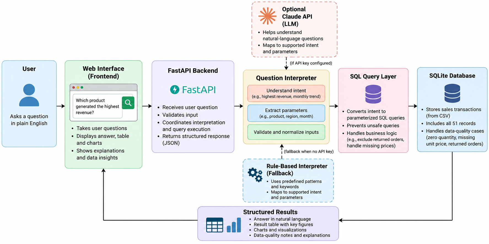

# Mini AI Business Intelligence Assistant

**Ask questions about sales data in plain English. Get answers backed by SQL, with tables, charts, and clear explanations.**

The Mini AI Business Intelligence Assistant turns a sales CSV into an interactive analytics experience. Instead of manually filtering spreadsheets or writing SQL queries, users can ask questions such as *“Which product generated the highest revenue?”* or *“How did revenue change between January and February?”* and receive structured, data-backed answers.

The focus of this project is not just answering questions, but answering them **accurately, transparently, and responsibly**. The application uses a question-interpretation layer to understand a question, validated query logic to retrieve the relevant data, and a simple interface to present the results.

## Key Features

- **Natural-language questions:** Ask supported sales questions in everyday English.
- **SQL-backed answers:** Revenue figures and rankings are calculated from the database, not generated by an LLM.
- **Visual analytics:** View supporting tables, charts, monthly trends, and percentage changes.
- **Product and regional rankings:** Find the highest- or lowest-revenue performers, second-highest results, and top or bottom rankings.
- **Month comparisons:** Compare revenue between two months and see the absolute and percentage change.
- **Transaction lookup:** Inspect individual transactions by transaction ID.
- **Order and data-quality reporting:** Understand completed and returned transactions, zero-quantity records, and missing prices.
- **Optional LLM interpretation:** Claude can help interpret loosely phrased questions when an Anthropic API key is configured.
- **Rule-based fallback:** The application can operate without an API key.
- **Transparent limitations:** Unsupported questions receive an explanation rather than a fabricated answer.

## Technology Stack

| Component | Technology |
|---|---|
| Backend API | Python, FastAPI |
| Database | SQLite |
| Data processing | Python CSV utilities and SQL |
| Frontend | HTML, CSS, JavaScript |
| Charts | Chart.js |
| Optional AI integration | Anthropic Claude API |
| Testing | pytest |

## Architecture

The application separates question interpretation from data retrieval. This keeps analytical calculations deterministic and makes results easier to test and explain.



The high-level request flow is:

1. The user submits a natural-language question through the web interface.
2. The FastAPI backend validates the request and checks whether it falls within the supported scope.
3. The interpreter maps the question to a supported intent and extracts relevant parameters.
4. Validated query logic runs the appropriate SQL against the SQLite database.
5. The application returns a structured answer and supporting data for the interface to display as text, tables, charts, or data-quality notes.

The optional LLM may help interpret a question, but numerical results are calculated using the application's validated query logic. Keep the Claude and fallback descriptions aligned with the implementation and the integration tests available in your repository.

## Supported Questions

Examples of supported questions include:

| Example question | What it returns |
|---|---|
| What is the total revenue? | Overall revenue from eligible transactions |
| Which product generated the highest revenue? | Product ranking and revenue |
| Which product generated the lowest revenue? | Lowest-revenue product |
| Which region performed worst in terms of revenue? | Region ranking from lowest to highest |
| Which product had the second-highest revenue? | Second distinct revenue rank |
| Which month had the highest revenue? | Monthly trend and peak month |
| What is the monthly revenue trend? | Monthly table, chart, and percentage changes |
| Did revenue increase from January to February? | Direction, absolute difference, and percentage change |
| How many orders are there? | Transaction counts by status and data-quality category |
| Which transactions have a missing unit price? | Transactions whose revenue cannot be calculated |
| What is the revenue for TXN0051? | Transaction details and its revenue status |
| How much revenue did returned orders lose? | Recorded returned-order sales value, with a clear limitation |

The interpreter supports a defined set of question types rather than every possible business question. Questions involving unsupported filters, arbitrary date ranges, profit, forecasts, or financial losses requiring unavailable data should be explained or refused rather than answered with unrelated totals.

## Data Handling and Quality

The supplied dataset contains **51 transactions**. Every readable transaction is retained, including records that cannot contribute a known revenue value.

| Case | Treatment |
|---|---|
| `TXN0034` — quantity is zero | Revenue is ₹0; marked as `zero_quantity` |
| `TXN0051` — unit price is missing | Unit price and revenue remain unknown; marked as `unknown_price` |
| `TXN0033` — returned transaction | Retained in the database but excluded from completed-sales revenue |
| Blank discount | Treated as zero, according to the data-loading rules |
| Invalid or unreadable row | Recorded in the rejected-row audit table with a reason |

A missing price is **not** treated as a zero price. Unknown revenue remains `NULL` and is excluded from revenue totals. A zero-quantity transaction, on the other hand, has a known revenue of ₹0.

For the supplied dataset, the expected data-quality summary is:

- **51** transactions loaded and **0** rejected.
- **50** completed transactions and **1** returned transaction.
- **49** completed transactions with known revenue.
- **1** zero-quantity transaction and **1** completed transaction with an unknown unit price.
- Total reported revenue of **₹14,39,200**.

These counts describe different categories and should not be added together as though they were mutually exclusive: the zero-quantity and missing-price cases are both among the completed transactions.

Returned orders are shown separately. Their recorded sales value is not presented as an actual financial loss because the dataset does not provide refund amounts, product costs, restocking costs, or shipping costs.

## Running the Project

### Prerequisites

- Python 3.10 or later is recommended.
- `pip` installed.
- An internet connection and an Anthropic API key are needed only if you want to use live Claude interpretation.

### 1. Open the project root

Extract the project and open the folder containing `requirements.txt`, `app/`, `static/`, `data/`, and `tests/` in your terminal or VS Code.

### 2. Create and activate a virtual environment

**Windows PowerShell**

```powershell
python -m venv .venv
.\.venv\Scripts\Activate.ps1
```

**macOS/Linux**

```bash
python3 -m venv .venv
source .venv/bin/activate
```

### 3. Install dependencies

```bash
python -m pip install -r requirements.txt
```

### 4. Start the application

From the project root, run:

```bash
python -m app.main
```

Open [http://127.0.0.1:8000](http://127.0.0.1:8000) in your browser.

The application initializes its SQLite database from the supplied CSV when required. If you encounter an import error, check that your terminal is in the project root rather than its parent directory.

### 5. Run the tests

```bash
python -m pytest -v
```

Run the complete test suite in your environment before submission and confirm that all tests pass.

## Optional Anthropic Integration

The application is designed to work without an API key. To enable Claude-based interpretation, configure the `ANTHROPIC_API_KEY` environment variable and restart the application.

**Windows PowerShell**

```powershell
$env:ANTHROPIC_API_KEY="your-api-key"
python -m app.main
```

**macOS/Linux**

```bash
export ANTHROPIC_API_KEY="your-api-key"
python -m app.main
```

Use your own valid key. Do not hard-code it into the source code or commit it to GitHub. Live API calls may incur charges according to your Anthropic account and model.

If the key is absent, the application should use its rule-based interpreter. If the LLM call fails, the application should fall back safely or explain the limitation, as implemented. A live API call is not guaranteed merely because a key is configured.

## API

The application exposes a question-answering endpoint:

```http
POST /ask
Content-Type: application/json
```

Example request:

```json
{
  "question": "Which product generated the highest revenue?"
}
```

The response contains a structured answer and supporting result data for the interface.

Additional endpoints include:

- `GET /api/mode` — reports the active interpretation mode.
- `GET /api/data-quality` — reports the dataset quality summary.
- `GET /docs` — interactive API documentation provided by FastAPI.

Check the actual API implementation and its response schema if you need to document a complete response example.

## Project Structure

```text
mini-ai-bi-assistant/
├── app/
│   ├── main.py
│   ├── db.py
│   ├── interpreter.py
│   ├── queries.py
│   └── __init__.py
├── data/
│   └── sales.csv
├── docs/
│   └── architecture.png
├── static/
│   └── index.html
├── tests/
│   ├── test_api.py
│   └── test_logic.py
├── requirements.txt
├── README.md
└── AI_NOTES.md
```

The structure above is illustrative. Adjust it to match the files actually present in your repository.

- `main.py` — API routes and HTTP-level error handling.
- `db.py` — CSV loading, validation, database initialization, and data-quality reporting.
- `interpreter.py` — maps natural-language questions to supported intents and parameters.
- `queries.py` — validated query execution and construction of structured answers.
- `static/index.html` — user interface, tables, and charts.
- `tests/` — tests for analytical logic, data-quality handling, and API behaviour.
- `docs/architecture.png` — architecture diagram displayed above.

## Reliability and Safety

The application is designed around these principles:

1. **Numbers come from the database.** Revenue values and rankings are calculated through query logic rather than invented by an LLM.
2. **SQL is controlled.** Questions are mapped to supported query templates rather than executed as arbitrary SQL.
3. **Inputs are validated.** Unsupported or ambiguous questions should not silently produce unrelated results.
4. **Data issues are visible.** Missing prices, returned orders, and zero quantities are handled explicitly.
5. **Results are explainable.** Answers include supporting tables, charts, and data-quality notes where appropriate.
6. **Tests protect important behaviour.** The test suite covers query interpretation, ranking, comparisons, malformed data, and API behaviour.

## Current Limitations

- The interpreter supports a defined set of question types, not every possible business question.
- Quarter-based analysis, arbitrary date ranges, and some advanced filters may be unsupported.
- The dataset does not contain enough information to calculate actual profit or the financial loss from returns.
- Claude interpretation requires a valid API key, network access, and an available API service.
- The sample dataset is static; the project is not a production sales platform with automatic data synchronization.

## Future Improvements

Potential extensions include CSV uploads with schema validation, richer product and region filters, more flexible time-period analysis, evaluation of LLM interpretation accuracy, and continuous integration for automated testing.

## Final Note

This project demonstrates how natural-language interfaces, relational databases, controlled AI interpretation, and data visualization can work together to make business data easier to explore without sacrificing the reliability of the underlying calculations.
